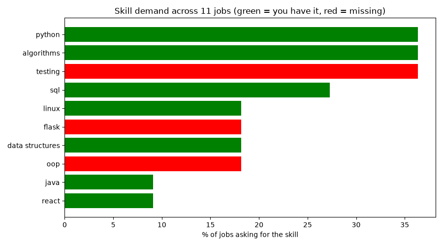

# Job Skill-Gap Analyzer

A Python tool that reads job descriptions, counts which skills companies ask for most, and shows which in-demand skills I am still missing. It has a command-line version and an interactive dashboard.

## Problem
Job postings list dozens of skills, and it is hard to know what to learn first. This tool measures real demand instead of guessing.

## Features
- Reads job descriptions from text files and counts skill mentions
- Matches skills as whole words (so `java` does not match `javascript`)
- Compares demand with my own skills and shows the gap
- Gives a match score
- **Command-line version:** stores every run in a SQLite database, queries the top missing skills with SQL, and saves a chart
- **Dashboard:** pick your skills, upload or paste job descriptions, filter by minimum demand, and switch between All / Have / Missing

## Screenshots




*Based on 11 Software Engineer fresher postings, Nov 2026.*

## Tech
Python 3, `re` (regex), `sqlite3`, Streamlit, Matplotlib, JSON

## How to run
```bash
pip install -r requirements.txt
```

Dashboard:
```bash
python -m streamlit run app.py
```

Command-line version:
```bash
python main.py
```

1. Put job descriptions in the `jobs` folder as `job1.txt`, `job2.txt`...
2. List your skills in `my_skills.txt`, one per line.
3. Edit `skills.json` to change which skills are searched.

## Limitations
- Small sample size (11 jobs)
- Keyword matching cannot understand synonyms such as "ML" and "machine learning"
- Results depend on which job roles were collected

## Future improvements
- Synonym handling
- A role selector (Software Engineer vs Data Analyst)
- Unit tests for the matching function
- A larger dataset